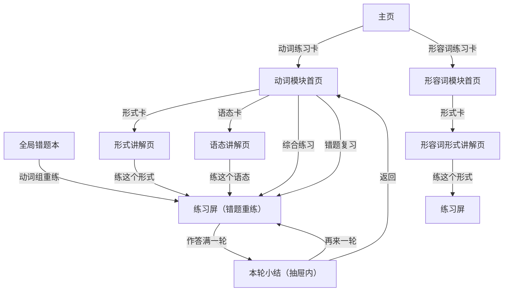

# 动词／形容词模块三层改造方案

> 状态：设计草案，待裁决 §9 的 Q-01～Q-06
> 日期：2026-10-17
> 参照：[android-particle-module-spec.md](android-particle-module-spec.md)（三层结构、掌握度口径、底栏规格）、[android-answer-screen-spec.md](android-answer-screen-spec.md)（两步式作答与判定抽屉）、[module-guide.md](module-guide.md)（模块接入清单）

## 0. 结论与范围

把 `SubPage.VERB` / `SubPage.ADJECTIVE` 从「直接进练习屏」改成与助词一致的三层：**模块首页 → 讲解页 → 练习屏**。改的是外壳与入口，**不动引擎、出题规则、判题口径**。

顺带补齐一件 D-008 一直延后的事：Android 端原来没有活用速查，改造后讲解页就是速查。

规模由数据决定（实测）：

| 模块 | 词条 | 活用形式 | 语态 | 组合数（词 × 形式 × 语态） |
| --- | --- | --- | --- | --- |
| 动词 | 44 | 18（11 基础 + 7 进阶） | 7（含原形） | **5 544** |
| 形容词 | 15 | 7 | — | 105 |
| 助词（已实现） | — | — | — | 48 道题 |

**5 544 个组合不能铺成卡片**。首页因此按「形式」组织（动词 18 + 语态 6 张，形容词 7 张），掌握度按「该形式下答对过多少个词条」计算。

---

## 1. 现状差异

| 维度 | 助词模块（已实现） | 动词模块（当前） | 形容词模块（当前） |
| --- | --- | --- | --- |
| 进入方式 | 主页卡片 → 模块首页 | 主页卡片 → **直接练习屏** | 主页卡片 → **直接练习屏** |
| 学习单元 | 9 个专题（固定题库） | 无（只有筛选器） | 无（只有筛选器） |
| 讲解 | 专题讲解页（入门/进阶 + 例句） | 无（只有练习中的「规律提示」开关） | 无 |
| 题目来源 | 48 道固定题 | 词条 × 语态 × 形式现算 | 词条 × 形式现算 |
| 掌握度 | 未用提示答对的题目 / 48 | 只有「已练词条数」（`progress.verbIds`） | 只有「已练词条数」 |
| 错题 | 题目 ID 数组，无排期 | 记录带 `dueAt`，有间隔复习 | 同动词 |
| 筛选 | 无（不分难度，D-018） | 类别 / 语态 / 形式 / 难度 | 类别 / 形式 / 难度 |

两个必须保留的既有能力：**筛选器**（动词四个维度）和**间隔复习**（错题有到期日）。它们不能因为「对齐助词」被抹平。

---

## 2. 三层信息架构

```text
主页
├── 动词练习 ── 动词模块首页
│   ├── 今日卡（今日 x 题 · 到期错题 n 道）
│   ├── 活用形式（11 基础 + 7 进阶，共 18 张卡）
│   ├── 语态（可能 / 受身 / 使役 / 短使役 / 使役受身 / 使役受身短，6 张卡）
│   ├── 综合练习（全部 5 544 组合）
│   └── 错题复习（按间隔复习的到期题）
└── 形容词练习 ── 形容词模块首页
    ├── 今日卡
    ├── 活用形式（7 张卡）
    ├── 综合练习（105 组合）
    └── 错题复习

任一形式/语态卡 ── 讲解页 ── 练习屏（预置该形式或语态）
```

### 2.1 页面清单

| 页面 | 路由 | 进入方式 | 返回 | 关键状态 |
| --- | --- | --- | --- | --- |
| 动词模块首页 | `VerbRoute.HOME` | 主页卡 | 回主页 | 无进度 / 有到期错题 / 全部形式已掌握 |
| 形式讲解页 | `VerbRoute.FORM(formId)` | 点形式卡 | 回模块首页 | 例词展开态 |
| 语态讲解页 | `VerbRoute.VOICE(voiceId)` | 点语态卡 | 回模块首页 | 同上 |
| 练习屏 | `VerbRoute.PRACTICE` | 讲解页「练这个」、综合练习、错题 | 回讲解页 / 模块首页 / 错题本 | 沿用现有 `VerbPracticeState` |
| 形容词对应三屏 | `AdjRoute.*` | 同上 | 同上 | 与动词同构，无「语态」段 |

### 2.2 跳转流程



返回栈与助词一致：练习中已作答时返回先弹「退出本轮？」；从错题本进入的复习，退出回错题本。

---

## 3. 模块首页：内容划分

```text
┌──────────────────────────────────────┐
│ ← 动词练习                  ◔ 18%    │  顶栏：返回 + 掌握度环
│                            8/44      │
├──────────────────────────────────────┤
│ ┌──────────────────────────────────┐ │
│ │ 今日动词                          │ │  今日卡
│ │ 已练 12 题 · 3 道错题到期         │ │
│ │ [ 随机 5 题 ]      [ 错题 3 道 ]  │ │
│ └──────────────────────────────────┘ │
│                                      │
│ 活用形式                     18 个   │
│ ┌───────────┐  ┌───────────┐        │
│ │ て形     练│  │ た形     练│        │  「练」= 直接开练
│ │ 基础       │  │ 基础       │        │
│ │ 43%       │  │ 20%       │        │
│ │ 19/44 词   │  │ 9/44 词    │        │
│ │ ▓▓▓▓░░    │  │ ▓░░░░░    │        │
│ └───────────┘  └───────────┘        │
│ … 基础 11 张                          │
│ ── 进阶 ──                            │
│ … 进阶 7 张                           │
│                                      │
│ 语态                          6 个   │
│ ┌───────────┐  ┌───────────┐        │
│ │ 可能形     │  │ 受身形     │        │
│ │ 12/44 词   │  │ 5/44 词    │        │
│ └───────────┘  └───────────┘        │
├──────────────────────────────────────┤
│ [        综合练习 · 全部组合      ]   │
└──────────────────────────────────────┘
```

### 3.1 分段规则

| 段 | 内容 | 数量 | 说明 |
| --- | --- | --- | --- |
| 今日卡 | 今日题数 + 到期错题 | 1 | 数字来自 `daily.verbAnswers` 与 `isReviewDue` |
| 活用形式·基础 | `INFLECTIONS` 中 `level = basic` | 11 | 辞书形也在此段（作为「原形」讲解入口） |
| 活用形式·进阶 | `level = advanced` | 7 | 命令形、そう、たい、ず、たり 等 |
| 语态 | `VOICES` 去掉 `base` | 6 | 每个语态以「辞书形」为练习形式 |
| 底部主按钮 | 综合练习 | 1 | 不预设语态/形式 |

形容词没有语态段，只有 7 张形式卡（同为 基础/进阶 两段）。

### 3.2 卡片规格（与助词专题卡同一套）

| 元素 | 规格 |
| --- | --- |
| 标题 | 形式标签（如「て形」「可能形」） |
| 副标题 | 基础／进阶；语态卡写「配合辞书形」 |
| 掌握度 | `x/44 词`（形容词 `x/15 词`）+ 进度条 + 百分比 |
| 右上角 | 「练」按钮（48dp 热区），长按整卡也可直练 |
| 点击卡身 | 进讲解页 |
| 顶栏环 | 全模块掌握度 = 各形式掌握度的算术平均？**不**——用「已掌握组合数 / (44 × 18)」会永远接近 0。改用 **各形式卡进度的加权平均**（权重 = 形式卡数），只作概览 |

> 顶栏环的口径必须写进 UI 说明，否则「18%」会被误读成「18% 的动词学会了」。

---

## 4. 讲解页：内容划分

改造后讲解页承担原来 Web「活用速查」的角色，**不新增任何文案数据**——全部由现有引擎现算。

### 4.1 形式讲解页（`formId`）

| 块 | 内容 | 数据来源 |
| --- | --- | --- |
| 标题行 | 形式标签 + 基础/进阶 chip | `InflectionInfo.label / level` |
| 一句话作用 | 该形式表达什么 | `InflectionInfo.meaning`（已有） |
| 三个例词 | 五段 / 一段 / 不规则各取一个，展示：辞书形 → 目标形式（书写 + 假名）+ `explain` 文本 | `VerbEngine.conjugate` + `VerbEngine.explain` |
| 变形要点 | 取上述三条 explain 的公共前缀？**不做文本归纳**，直接并列三条，让差异自己呈现 | 同上 |
| 底栏 | 「练这个形式（44 个词条）」 | — |

关键取舍：现有引擎**没有「按形式的通用规则文本」**，只有按具体词的 `explain`。方案不去造通用文案（造了就要维护、且容易与引擎实际行为不一致），而是用「三个真实词例并列」呈现规则。这是本方案最重要的一个设计决定。

### 4.2 语态讲解页（`voiceId`）

| 块 | 内容 | 数据来源 |
| --- | --- | --- |
| 标题行 | 语态标签 | `VoiceInfo.label` |
| 一句话作用 | 语态含义 | `VoiceInfo.meaning`（已有） |
| 三个例词 | 五段 / 一段 / 不规则，展示「辞书形 → 该语态的辞书形」+ `explain` | `conjugate(verb, voice, "dictionary")` |
| 底栏 | 「练这个语态（44 个词条）」 | — |

### 4.3 形容词形式讲解页

同 4.1，例词取「い形容词 / な形容词 / 特殊（いい）」各一个。当前 Android 形容词 7 个形式，缺 `conditional`、`mizen`、`imperativeRequest`（Web 有 10 个），见 Q-04。

---

## 5. 练习屏：只做三处改动

现有 `VerbPracticeScreen` / `AdjectivePracticeScreen` 保留，改造只加三个参数：

| 改动 | 内容 | 不做的 |
| --- | --- | --- |
| 1. 初始 scope | `initialInflection` / `initialVoice`（可空）。讲解页进入时预置，筛选器仍可改 | 不改题池生成、不改随机策略 |
| 2. 标题与返回 | 顶栏标题改为「て形 · 原形」这类组合名；返回目标改为讲解页 | 不动 `PracticeTopArea` 的布局结构 |
| 3. 掌握度记账 | 答对且**未开提示**时写入 mastered 组合 | 不改判题、不改错题间隔复习 |

练习屏里原有的筛选项（类别 / 语态 / 形式 / 难度）全部保留：从形式卡进来时是「形式已锁定、其余可调」，从综合练习进来是「全空」。

---

## 6. 交互与视觉规范（三模块共用）

| 项 | 规格 | 来源 |
| --- | --- | --- |
| 卡片 | 16dp 圆角、1dp `outlineVariant` 细边、2dp 阴影、内边距 12/11/10 | 助词专题卡 |
| 顶栏 | 返回 + 标题 + 右侧掌握度（环 30dp + 百分比 + `x/n`） | 助词模块首页 |
| 底部抽屉 / 底栏 | 无抓手、16dp 顶圆角、1dp 细边、2dp 阴影、内边距 16/12/12、背景铺到屏幕底 + `navigationBarsPadding()` | 2026-10-17 底栏改版 |
| 主按钮 | 通栏、12dp 圆角、`primary` 底 | 三个模块一致 |
| 次按钮 | 描边、与主按钮同高 | 助词模块首页 |
| 作答 | 两步式（选择 → 确认提交）、双击同项 300ms 直提、判定后抽屉展开 | 答题屏契约 |
| 判定后 | 题面压缩、正确项 `bringIntoView` | 答题屏契约 |
| 动效 | 只沿用现有：扫光、`animateContentSize` | — |
| 无障碍 | 卡片同时提供「练」按钮（长按不是唯一路径）；选项 contentDescription 含序号与状态 | 助词模块 |

跨尺寸：首页网格固定 2 列，卡片高度由内容决定；底部条用 `navigationBarsPadding()`，不写死高度。800×1280 与 1080×2340 已实测过同一套底栏（见助词截图 13/14）。

---

## 7. 数据与存储

### 7.1 新增字段（都不迁移旧数据）

| 键 | 新字段 | 含义 | 兼容策略 |
| --- | --- | --- | --- |
| `japanese-verb-practice-progress-v1` | `verbMastered: List<String>` | `voiceId::inflectionId::verbId` 去重集合 | 缺失按空；旧 `verbIds` 语义不变（已练词条） |
| 同上 | `adjMastered: List<String>` | `formId::adjectiveId` | 同上 |

### 7.2 掌握度口径（三模块统一）

- **只在「答对 且 本题未开提示」时计入**。
- 助词是 48 道固定题；动词/形容词是「组合」，按 `(voice, inflection, verbId)` 去重。
- 卡片掌握度 = 该形式下已掌握的**词条数** / 词条总数（44 或 15）。分母固定，卡片之间可比较。
- 提示记账：现有动词练习的「显示规律提示」同时控制假名，改造时加一个内部 `hintUsedThisQuestion` 标记，**不改按钮语义**。

### 7.3 错题保持原样

动词/形容词错题带 `dueAt`，与助词的「无排期」不同。首页今日卡显示的是**到期数**（`isReviewDue`），文案不能照抄助词的「错题 n 道」。

---

## 8. 测试与验收

| 层 | 内容 |
| --- | --- |
| 纯逻辑 | 新增 `MasteryProgress`（组合解析/聚合/去重），单测：同题重复不计、提示态不计、跨形式不串 |
| 存储 | 旧 JSON 缺新字段 → 默认空；脏 ID 丢弃（参考 `ParticleStoreCompatTest` 的做法，无 Context 则用纯函数测解析） |
| 引擎 | 不改，`ParticleEngineTest` / `VerbEngineTest` / 跨端样例全部视为基线，验收时复跑 |
| UI | 首页卡片数量 = 形式数（+语态数）；点卡进讲解页；讲解页三个例词 = 三组不同类别；练习屏带入 scope；退出确认；返回栈 |
| 回归 | Web 111/111、Android ≥60 项全绿；三模块底栏视觉一致（截图比对） |

---

## 9. 待裁决

| 编号 | 问题 | 选项 | 我的建议 |
| --- | --- | --- | --- |
| Q-01 | 首页主轴 | A 按活用形式（18+6 卡）<br>B 按语态优先（7 卡，形式作为二级）<br>C 按词条（44 卡） | A。形式是学习者最常问的「怎么变」，语态是它的修饰维度；C 是 5 544 组合的入口灾难 |
| Q-02 | 掌握度单位 | A 形式下已掌握词条数 / 44<br>B (voice, inflection) 组合达标 / 126<br>C 已练词条数（沿用现状） | A。分母固定、卡片可比较；C 会把「看过」当「会了」 |
| Q-03 | 讲解页是否新增「通用变形规则」文案 | A 不加，用三个真实例词并列<br>B 新增 18+6 条形式说明（内容工作） | A。引擎只有按词的 explain，硬写通用文案容易与实际规则不一致 |
| Q-04 | 是否先补齐数据差距 | A 先补：Android 形容词 7→10 形式、动词 44→79 词<br>B 先改结构，数据后补 | B。结构独立于词库规模；但**要先补形容词形式**，否则首页只显示 7 张卡、与 Web 讲的内容对不上 |
| Q-05 | 是否保留「按词条速查」 | A 不做，讲解页只按形式<br>B 讲解页加「换个词看看」切换 | A 起步，B 作为后续增强 |
| Q-06 | 三模块的外壳是否抽公共组件 | A 复制 `ParticleFlow` 两份，稳定后再抽<br>B 立刻抽 `ThreeTierFlow` + 公共卡片组件 | A。`module-guide.md` 原则 6：多个模块形成稳定共性后再抽象；但卡片、底栏这类**纯视觉组件**可以现在就抽 |

---

## 10. 关键点与风险

| # | 关键点 | 风险 | 处理 |
| --- | --- | --- | --- |
| 1 | 组合数 5 544，不能按组合铺 | 首页做成迷宫 | 按形式聚合，分母固定为词条数 |
| 2 | 现有练习屏是唯一能做对题的屏幕 | 改结构时把筛选/双击/抽屉改坏 | 练习屏只加三个参数，不动内部逻辑；改完逐项回归答题契约 |
| 3 | 引擎没有「按形式的通用说明」 | 讲解页写成与引擎不一致的伪规则 | 只用 `meaning` + 三例词 + 引擎 `explain`，不自造规则 |
| 4 | 提示记账缺失 | 掌握度虚高（靠提示答对也算会） | 加内部标记，与助词同口径 |
| 5 | 错题有 `dueAt`，助词没有 | 首页文案照抄会说出不存在的「不做排期」 | 首页分别写「到期 n 道」与「错题 n 道」 |
| 6 | Android 形容词 7 形式 < Web 10 | 首页与讲解页内容少于 Web，两端认知不一致 | 先补 3 个形式（Q-04），再上首页 |
| 7 | 旧 `progress.verbIds` 语义 | 迁移时把「练过」误当「掌握」 | 新字段独立，不迁移、不回填 |
| 8 | 导航多一层 | 返回栈与「练习中退出」不一致 | 直接复用 `ParticleFlow` 的 `pendingAction` 模式 |
| 9 | 12/13/14 截图那套底栏规格 | 三个模块各写一套，视觉漂移 | 抽出 `ModuleCard` / `ModuleTopBar` / `DockSurface` 三个视觉组件 |
| 10 | 无障碍 | 卡片只能长按/只能点 | 卡面点击 + 显式「练」按钮，两者都有 contentDescription |

---

## 11. 实施顺序（每步可独立验收）

| 步 | 内容 | 验收 |
| --- | --- | --- |
| S1 | 数据口径：`verbMastered` / `adjMastered` + `MasteryProgress` 纯函数 + 单测 | 单测全绿；旧数据不崩 |
| S2 | 视觉组件：`ModuleTopBar` / `ModuleCard` / `DockSurface` 从助词模块抽出并替换现有实现 | 助词模块视觉零回归（比对 12/13/14 截图） |
| S3 | 动词/形容词模块首页 + 导航壳（练习屏仍是第三层，scope 可空） | 能进能出、卡片数正确、掌握度显示 |
| S4 | 讲解页（形式 + 语态两种主题） | 三个例词类别正确、练习带 scope 进入 |
| S5 | 收口：首页「错题/今日」口径、返回栈、无障碍、视觉回归 | 全量测试 + 小屏复核 |

S1～S2 不改用户可见行为，可以先合；S3 起才开始替换入口。

---

## 变更记录

- 2026-10-17：初稿。基于现有 Android 模块（动词 44 词 / 18 形式 / 7 语态，形容词 15 词 / 7 形式）与助词模块三层结构编写。
