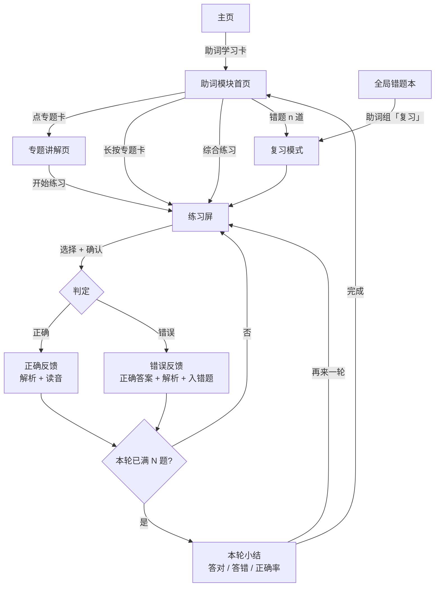

# Android 助词学习模块 · 设计方案

> 状态：设计已定稿（2026-10-17 关子裁决 Q-01～Q-06，见 §7）；待实现
> 日期：2026-10-17
> 关联：[android-two-tab-spec.md](android-two-tab-spec.md)（两级导航与主页入口）、[android-answer-screen-spec.md](android-answer-screen-spec.md)（选择题契约：两步式作答、判定抽屉、辅助开关）、[module-guide.md](module-guide.md)（模块接入清单）、[decisions.md](decisions.md)（D-016～D-021）

## 0. 结论与现状

Android 端没有任何助词代码（`android/app/src/main/java/...` 下无 particle 包），而 Web 端已有完整的助词模块。本方案把 Web 的**内容与判题规则**移植为 Kotlin 原生实现，界面按 Android 已确认的答题契约重做，不引入 WebView。

现有可复用资产（实测数据，取自 `web/particle-engine.js`）：

| 项 | 值 |
| --- | --- |
| 专题 | 9 个：`topic-focus`（は／が）、`location`（に／で）、`destination-direction`（に／へ）、`object-route`（を）、`noun-link`（の）、`listing`（と／や）、`addition`（も）、`range`（から／まで）、`limitation`（だけ／しか） |
| 题量 | 48 题 = 选助词 24 + 判作用 24；`level` 标注入门 28 + 进阶 20（**仅用于解析深度，不做难度分层**，见 D-018） |
| 每专题题量 | 4–8 题；「难度 × 题型」四格各有至少 1 题，但单格常只有 1–2 题 |
| 每专题例句 | 2 条，含 `context / sentence / reading / translation / note` |
| 讲解 | 每专题 `beginnerSummary` + `advancedSummary` 两段 |
| 每题字段 | `context / before / after / readingBefore / readingAfter / translation / options[4] / acceptedAnswers / beginnerExplanation / advancedExplanation`，判作用题另有 `targetParticle / targetReading` |
| 特殊数据 | 有 1 道**多可接受答案**的题（`he-destination`：へ 与 に 都成立） |

### 0.1 已裁决要点

| 项 | 裁决 | 对本方案的影响 |
| --- | --- | --- |
| Q-01 错题存储 | A：`japanese-particle-practice-mistakes-v1`，纯题目 ID 数组 | 与 Web 同构；**没有跨会话时间排期**，见 §3.6 |
| Q-02 错题归属 | B：并入全局错题本，按模块分组 | 错题本新增第三组「助词」，入口从两处可达 |
| Q-03 内容字段 | B：补 `optionNotes` 与 `contrastGroup` | 先改 `web/particle-engine.js` 再生成 Kotlin，见 §4.2 |
| Q-04 难度 | 不做难度区分 | 48 题同池，无难度选择器；解析深度仍按 `level` 取 |
| Q-05 专题卡长按 | B：做长按直接开练 | 同时保留显式「练」按钮，不把长按当唯一路径 |
| Q-06 掌握度展示 | B：显示百分比与环形图 | 顶栏环形图 + 百分比；专题卡给百分比 |
| Q-09 首页形态 | **A：专题地图**（见 [design/particle-prototypes.html](design/particle-prototypes.html)） | 2 列专题网格 + 今日卡 + 固定综合按钮；B/C/D 的可用部分作为后续增强 |

三条设计原则：

1. **复用答题契约，不新造交互**：选择题界面、两步式提交、双击快捷提交、判定后强制显示读音、抽屉展示解析，全部沿用 `android-answer-screen-spec.md`。
2. **错题进全局、内容留模块**：助词错题写 `mistakes-v1`（ID 数组），在全局错题本里作为独立分组呈现；讲解、练习、复习入口仍在模块内。
3. **数据同源**：Kotlin 侧题目数据由 `web/particle-engine.js` 生成的样例校验，不手工双写漂移。

---

## 1. 信息架构与页面流程

### 1.1 层级位置

助词模块是**二级页**，不是底栏第三个标签。

```text
底栏（一级，仅主页 / 我的）
主页
├── 动词练习        → 二级页
├── 形容词练习      → 二级页
├── 助词学习        → 二级模块（本次新增）
└── 错题本          → 二级页（含助词组，可直达助词复习）

助词模块内部（三级）
├── 模块首页（专题地图）
│   ├── 今日助词卡 ── 继续上次 / 开始 5 题
│   ├── 专题卡 ×9   ── 单击：专题讲解页；长按：直接开练
│   ├── 综合练习     ── 练习屏（全题库）
│   └── 错题 n 道    ── 练习屏（复习模式）
```

理由：2026-10-15 的底栏重设计已把动词／形容词／错题本降为二级页，底栏只保留「主页／我的」。助词与它们是同级能力，放三级入口会破坏既有信息层级；底栏加第三个 tab 又要重排已确认的导航。`module-guide.md` 也要求「新模块导航项仅在功能可用时显示」，用主页卡片 + 二级页最省冲突。

### 1.2 页面清单

| 页面 | 路由标识 | 进入方式 | 返回 | 主要内容 | 关键状态 |
| --- | --- | --- | --- | --- | --- |
| 助词模块首页 | `SubPage.PARTICLE` | 主页「助词学习」卡 | 系统返回 → 主页 | 今日助词卡、9 专题网格、综合练习、错题入口 | 无进度、有错题、全部专题已掌握 |
| 专题讲解页 | `ParticleRoute.Lesson(lessonId)` | 点专题卡 | 返模块首页 | 专题标题、助词徽标、入门说明 + 进阶折叠、2 条例句（先遮 `translation`+`note`）、开始练习 | 进阶折叠态、例句未揭示／已揭示 |
| 练习屏 | `ParticleRoute.Practice(scope)` | 讲解页「开始练习」、模块首页「综合练习」、错题卡 | 返上一层（练习中可确认退出） | 进度环、题干卡、选项组、判定抽屉 | idle / picked / hinted / judged / roundEnd / emptyReview |
| 复习模式 | 同上（`scope = Review`） | 模块首页错题入口、**全局错题本助词组** | 来自错题本则返错题本，否则返模块首页 | 顶部常驻复习横幅 + 剩余题数 | 与练习屏同状态机 |

`scope` 三态：

| scope | 参数 | 题池 |
| --- | --- | --- |
| `Lesson` | `lessonId` | 该专题全部 4–8 题 |
| `All` | 无 | 全部 48 题，强制交替两题型、不连续同专题 |
| `Review` | 无 | `mistakes-v1` 中的题目，按加入顺序（先错先练） |

不设 `level` 参数（D-018）。

### 1.3 主流程



### 1.4 返回栈与状态保留

沿用现有 `BackHandler` + `sub` 字符串的做法，但助词模块内部需要三级，因此在模块内部再维护一个路由变量：

| 动作 | 行为 |
| --- | --- |
| 练习屏按系统返回 | 若已作答 ≥1 题，弹确认（「本轮进度不保存，退出？」）；未作答直接退到讲解页／模块首页 |
| 讲解页按返回 | 回模块首页 |
| 模块首页按返回 | 回主页（底栏重新出现） |
| 从全局错题本进入复习 | 返回键回错题本，不进模块首页（来源记为 `origin`） |
| 切到「我的」再切回 | 练习状态保留（与现有动词／形容词状态提升到根级一致），不重开一轮 |
| 进程重启 | 只持久化错题、统计、掌握进度；当前题与选中项不落盘（对齐答题契约 §4.6） |

### 1.5 设计理由

- **三级而非平铺**：专题讲解与练习是「内容 → 训练」的因果链，放在同一页会让题干被说明文字挤压；分层后练习屏独占整屏高度，符合单手操作与题面可读性。
- **模块首页做地图而不是直接进练习**：助词的学习单元是「专题」，用户需要先知道自己在学哪一组对立（は／が、に／で），再决定练哪个。直接进综合练习会让 9 个专题混成一锅，初学者无法建立分类框架。
- **常驻「综合练习」+ 长按直练**：地图式首页有「只能点卡 → 再点开始」的路径依赖，熟手要 4 次点击才能开始。固定综合入口压到 1 次，长按专题卡压到 1 次长按。

### 1.6 取舍

| 选择 | 收益 | 代价 | 处理 |
| --- | --- | --- | --- |
| 二级页而非底栏 tab | 不动已确认导航，底栏不拥挤 | 助词入口比动词多一层 | 主页卡片副标题给「9 专题 · 已掌握 25%」，单击即进 |
| 模块首页放 9 张专题卡 | 分类框架可见，进度可视 | 首屏信息量大于动词模块的「直接开练」 | 顶部今日卡承担「不知道练什么」的决策 |
| 讲解独立成页 + 长按直练 | 初学者有内容、熟手有捷径 | 长按是隐藏交互，可发现性差 | 卡片右上角保留显式「练」按钮（48dp 热区），长按只是加速；首次进模块时今日卡下方给一行说明 |

---

## 2. UI 设计方案

### 2.1 模块首页

```text
┌──────────────────────────────────────┐
│ ← 助词学习                    ◔ 25%  │  顶栏：返回 + 掌握度环
│                              12/48   │
├──────────────────────────────────────┤
│ ┌──────────────────────────────────┐ │
│ │ 今日助词                          │ │  今日卡
│ │ 3 道错题 · 建议先还 1 道          │ │
│ │ [ 开始 5 题 ]      [ 错题 3 道 ]  │ │
│ └──────────────────────────────────┘ │
│                                      │
│ 专题                          9 个   │
│ ┌───────────┐  ┌───────────┐        │  2 列网格
│ │ は / が  练│  │ に / で  练│        │  右上角「练」= 直练
│ │ 话题与焦点 │  │ 场所与范围 │        │
│ │ 50%       │  │ 0%        │        │
│ │ 3/6 题     │  │ 0/8 题     │        │
│ │ ▓▓▓░░░    │  │ ░░░░░░    │        │
│ └───────────┘  └───────────┘        │
│ … 共 9 张（单击看讲解，长按直接练）   │
│                                      │
├──────────────────────────────────────┤
│ [        综合练习 · 48 题        ]   │  固定底栏按钮
└──────────────────────────────────────┘
```

要素规格：

| 要素 | 规则 |
| --- | --- |
| 顶栏掌握度 | 环形进度（直径 28dp）+ 百分比 + `x/48`；已掌握 = 该题**未用提示答对过**（去重） |
| 今日卡 | 有错题时主按钮「开始 5 题」（本轮首题插一道错题），副按钮「错题 n 道」；无错题时副文案「题库已清空，继续综合练习」 |
| 专题卡 | 标题（助词对）+ 中文副标题 + 百分比 + `x/n 题` + 进度条；右上角「练」按钮直接开练 |
| 专题卡交互 | 单击 → 讲解页；点「练」或长按 → 练习屏（`scope = Lesson`）；长按 400ms 触发一次轻触反馈 |
| 综合练习 | 固定底部主按钮，48 题；二级页已隐藏底栏，不冲突 |
| 空状态 | 从未练习：今日卡显示「先看一个专题，或直接做 5 题」；全部掌握：顶栏环满，今日卡文案改为「48 题全部掌握 · 可以只做错题复习」 |

### 2.2 专题讲解页

```text
┌──────────────────────────────────────┐
│ ← 话题与焦点                    [练] │
├──────────────────────────────────────┤
│  [は]  [が]                           │  助词徽标
│                                      │
│  は提示这句话要谈论的主题；が常用来… │  入门说明（常显）
│  ▸ 再进一步：は也能形成对比话题…      │  进阶说明（折叠）
│                                      │
│  例句 1 / 2                           │
│  ┌──────────────────────────────────┐ │
│  │ 自我介绍                          │ │  context
│  │ 私は学生です。                    │ │  sentence（助词加粗）
│  │ わたしはがくせいです。            │ │  读音
│  │ [ 看讲解 ]                        │ │  未揭示态
│  └──────────────────────────────────┘ │
│  ┌──────────────────────────────────┐ │
│  │ 回答“谁来了？”                    │ │
│  │ 田中さんが来ました。              │ │
│  └──────────────────────────────────┘ │
│                                      │
├──────────────────────────────────────┤
│ [        开始练习（本专题 6 题）   ]  │
└──────────────────────────────────────┘
```

关键交互：

- **两层说明同页，不做层级切换**（D-018）：入门说明常显，进阶说明折叠为「再进一步」。取消难度选择器后，用户不需要先决定「我是入门还是进阶」，阅读时按需展开。
- **先猜后证**：例句默认只显示日文句，`translation` 与 `note` 折叠在「看讲解」后。理由见 §4.5。
- **开始练习**按钮括号内为当前专题题量（实测 4–8 题），池子小于 5 时如实显示。

### 2.3 练习屏

沿用答题契约的「题面卡 + 选项组 + 判定抽屉」三段式，仅题干与选项内容按助词题改造。

```text
┌──────────────────────────────────────┐
│ ←   ◔ 2/5   「は / が」  [显示提示]  │  进度环 + 专题 + 辅助开关
├──────────────────────────────────────┤
│ 自我介绍，说明自己的身份。            │  context（muted，小字）
│                                      │
│      私 〔  〕 学生です。             │  填空位（虚线框）
│      わたし がくせいです。            │  读音（关提示时占位）
│ ┌──────────────────────────────────┐ │
│ │ は 把「我」设为这句话的话题，…    │ │  提示面板（展开态）
│ └──────────────────────────────────┘ │
├──────────────────────────────────────┤
│  ① は      ② が                      │  fill：2 列网格，大字
│  ③ を      ④ で                      │
├──────────────────────────────────────┤
│        已选：は     [ 确认提交 ]      │  抽屉收起态
└──────────────────────────────────────┘
```

判作用题的题干改为整句显示并把目标助词高亮（下划波浪 + 强调色），选项是 4 条作用描述（可两行）：

```text
│  天気 が いいから、散歩しましょう。   │
│  てんき が いいから、さんぽしましょう。│
│  ① 标出「いい」所描述的主体（天气）   │
│  ② 把天气设为整段谈话的话题           │
│  ③ 表示天气是散步提议的原因           │
│  ④ 连接前后分句表示转折               │
```

### 2.4 关键状态

| 状态 | 触发 | 界面表现 |
| --- | --- | --- |
| 未作答 `idle` | 进入新题 | 选项可点；确认按钮禁用；提示面板收起；读音为占位 |
| 已选 `picked` | 点选项 | 该选项选中态；确认可用；提示行「再次点击可直接提交」 |
| 提示 `hinted` | 点辅助开关 | 读音显示 + 入门说明展开（进阶说明折叠）；该题标记 `hintUsed`；答案不改 |
| 正确 `judged(correct)` | 提交且命中 | 选项锁定，正确项绿框；整卡绿色扫光；抽屉展开：正确标题 + 正确答案 + 入门解析 + 读音；答对计数 +1 |
| 错误 `judged(wrong)` | 提交且未命中 | 选中项红框、正确项绿框；红色扫光；抽屉展开：正确答案 + 入门解析 + 进阶解析 + 你的选择为什么不适用；错题入 `mistakes-v1` |
| 多答案 `judged(acceptedAlt)` | 命中 `acceptedAnswers` 非首个 | 判对，抽屉追加一行「に 也成立；这里 へ 更突出方向」（仅 `he-destination` 一题） |
| 一轮完成 `roundEnd` | 答满本轮题量 | 抽屉切换小结：答对／答错／正确率 + 「再来一轮」「回到专题」；本轮计 1 个任务 |
| 空错题 `emptyReview` | 复习模式且 `mistakes-v1` 为空 | 显示「没有待复习的助词错题」+「去综合练习」；不静默降级为普通练习 |

动画与触觉沿用现有实现：扫光 1 次、抽屉 `animateContentSize`、提交时一次轻触反馈。不新增自定义动画曲线。

### 2.5 视觉令牌

复用 `ui/theme/Theme.kt` 的 `paperColors()`，新增 3 个语义令牌（禁止在组件内写死色值）：

| 令牌 | 用途 | 取值来源 |
| --- | --- | --- |
| `particleAccent` | 目标助词高亮、填空位边框 | 由 `--green` 派生（与 primary 同族，避免引入第二主色） |
| `hintSurface` | 提示面板底色 | 由 `--green-pale` 派生 |
| `masteryTrack` / `masteryFill` | 进度条与掌握度环 | `--line` / `--green` |

### 2.6 设计理由

- **题面卡三段固定**（语境 / 句子 / 读音）：语境先行是助词题的信息前提（同一个 `に` 在「场所」与「目的地」下答案不同）；读音行给 N3 以下学习者兜底；两者都在题面卡内，判定时不跳动。
- **选项用等宽大字（fill）**：助词是单字，2 列网格能一眼扫完四个，且热区大；判作用题文字长，改竖排四行。
- **抽屉承载解析而不是弹窗**：与动词／形容词完全一致，用户不需要学习第二套交互；且解析常驻可反复看。
- **多答案题必须判对**：这是数据里真实存在的例外（`he-destination` 接受 へ 与 に），若按 `options[0]` 判会制造错误错题。

### 2.7 取舍

| 选择 | 收益 | 代价 | 处理 |
| --- | --- | --- | --- |
| 选择题，不做输入 | 移动端不需要切输入法，热区大，判题确定 | 只练「识别」，不练「产出」；学习者可能拼不出假名 | 明确写入限制；未来若做输入式，复用动词模块的 IME 守卫经验 |
| 四选一而非二选一 | 选项来自同一专题的助词集合，干扰项同类，排除法空间小 | 比二选一多两个读项，认知负荷高 | 选项始终来自本专题 `particles`，不掺无关助词 |
| 选项每次洗牌 | 防止记住「第二项总是对的」 | 位置记忆不可复用，熟练度提升感变弱 | 洗牌在引擎层做，测试锁定不出现固定位置 |
| 判定抽屉自动展开 | 解析即时可见，符合即时反馈 | 遮挡选项区，想回看原选项需滚动 | 抽屉高度按内容自适应，选项锁定后仍可上滑查看 |
| 百分比 + 环形图 | 进度一目了然，动机明确 | 48 题基数小，两天能刷满；百分比会放大「差 2 题」的刷分心态 | 掌握度只认「未用提示答对」，刷不出来；顶栏环下标注口径，长按显示定义 |
| 长按直练 + 显式「练」按钮 | 熟手 1 步进练习 | 卡片右上角多一个控件，视觉略密 | 「练」按钮用次级样式（24dp 图标 + 48dp 热区），不抢标题 |
| 不分难度（D-018） | 少一层决定，48 题全部可达 | 初学者可能直接撞上偏难的题 | 每轮题池按「先讲解过的专题优先」排序；解析始终给入门段，答错再补进阶段 |

---

## 3. 学习操作逻辑

### 3.1 闭环

```text
讲解 ──▶ 例句演示 ──▶ 练习 ──▶ 即时反馈 ──▶ 错题（全局可见）
  ▲                                  │              │
  └──────── 解析里的出口 ────────────┘              │
  ▲                                                │
  └──────── 每轮首题插一道错题 / 复习模式 ◀──────────┘
```

### 3.2 知识点讲解

| 项 | 规则 |
| --- | --- |
| 内容组织 | 入门说明常显；进阶说明折叠为「再进一步」，点击展开，不记住展开态 |
| 助词徽标 | 显示本专题所有助词（は／が） |
| 与练习联动 | 讲解里的进阶折叠**不影响**练习难度；解析深度按题目的 `level` 字段取（答对取入门解析，答错取入门 + 进阶） |
| 进入即读 | 不强制「已读」门禁，允许直接开练（长按直练就是这条的极端形式） |

### 3.3 示例演示（先猜后证）

1. 例句默认只显示 `context` + `sentence` + `reading`，`translation` 与 `note` 折在「看讲解」后。
2. 用户先在心里判一次助词作用，再揭示。这是「检索练习」的最小形式，成本为零。
3. 揭示后 `note` 用独立底色块呈现，与练习解析同族，形成「讲解 → 解析」的视觉连续。
4. 补 `contrastGroup` 后（D-019），同组例句以对比卡并排：同句、两个助词、两个译文（见 §4.2）。
5. 不提供朗读：项目无 TTS、无音频资源，不伪造语音按钮。

### 3.4 练习范围与认知阶梯

不设难度分层（D-018）。练习只有三档范围，认知阶梯由**交互方式与题型**驱动：

| 阶梯 | 认知动作 | 触发方式 | 题库来源 |
| --- | --- | --- | --- |
| S1 认读 | 在明确规则下认出助词 | 点「显示提示」，规则与读音同时出现 | 任意题 |
| S2 辨析 | 无提示，从同类助词中选对 | 不点提示直接作答（fill） | fill 24 题 |
| S3 释义 | 说出助词在当前句中的作用 | function 题型（整句 + 目标助词高亮） | function 24 题 |
| S4 迁移 | 跨专题、跨题型判断 | 综合练习：强制交替两题型 + 跨专题抽题 | 全部 48 题 |

- 题量：`本轮题量 = min(5, 题池大小)`。全库 48 题恒为 5；单专题 4–8 题，池 ≤5 时一轮即全部。
- 出题顺序：`Lesson` / `All` 模式下若错题非空，**本轮首题从错题里取**（见 §3.6）；其余题洗牌；同一轮不重复；`All` 模式不连续两题同专题。
- 题池不被"消耗"：不记录已练题、不做去重排除，同一题可在一轮内再次出现（概率低，洗牌决定）。
- 不提供难度切换控件；`level` 字段只影响解析文本与内容排序，不进入用户可见的筛选。

### 3.5 即时反馈

判定后的抽屉内容按「正误 → 答案 → 为什么 → 你的选项」四层：

| 层 | 正确时 | 错误时 |
| --- | --- | --- |
| 结论 | 「答对」 | 「答错」 |
| 答案 | 正确助词 / 正确作用描述 | 正确答案（高亮） |
| 解析 | `beginnerExplanation` | `beginnerExplanation` + 折叠的 `advancedExplanation` |
| 你的选择 | 不显示 | 显示选中项 + `optionNotes[选中项]`（补齐前用「本句语境不成立」+ 整句解析兜底） |
| 译文 | 立即显示 `translation` | 立即显示 `translation` |

> 数据缺口（D-019 要补）：现有 48 题没有逐选项干扰说明。补 `optionNotes` 之前，错误反馈只能给「你选的 X 不适用于本句」+ 整句解析；补齐后按选项精确归因。

### 3.6 错题与复习

裁决（Q-01 A + Q-02 B）带来的完整语义：

| 项 | 规则 |
| --- | --- |
| 存储形态 | `japanese-particle-practice-mistakes-v1` = `List<String>`（题目 ID，去重，append 顺序即加入顺序），与 Web 端逐字节同构 |
| 加入 | 练习中答错即追加（已存在则不重复） |
| 移出 | **复习模式下答对即移出**（与 `web/app.js:2026` 的 `removeParticleMistake` 同义） |
| 毕业粒度 | 一次答对毕业（不做连续 N 次） |
| 会话内重现 | 答错后隔 4 道已作答题重现（复用 `sessionAnswerCount`，纯内存，不落盘） |
| 跨会话排期 | **不做**。没有 `dueAt` / `intervalDays` 字段，因此不存在「今天到期 n 道」 |
| 每轮插队 | 练习（`Lesson` / `All`）的**首题**若错题非空则从错题取，取最近加入的（数组尾部）——把「时间排期」换成「每次开练先还一道」 |
| 入口 | 模块首页「错题 n 道」；全局错题本「助词」组「复习 n 道」 |
| 全局错题本呈现 | 新增第三组：每行显示语境 + 句子（截断 1 行），右侧标签「待复习」，不显示到期时间；组头「复习 n 道」进入 `scope = Review` |
| 空态 | 无错题时模块首页副按钮禁用并显示「暂无错题」；复习模式空态给「去综合练习」 |
| 答对判定 | 与练习同一条判题路径；提示态答对**同样移出**（复习的目标是能判断，提示是允许的脚手架，见 §3.9 的取舍说明） |

**失去间隔排期的后果与补偿**（这一条必须在实现时一并落地，否则复习会退化成"想起来才做"）：

1. 没有「到期」概念 → 首页用「错题 n 道」而非「今日到期 n 道」。
2. 排期功能由**每轮首题插队**承担：只要用户还在练助词，就每轮必碰一道错题。
3. 错题多时（>10 道）首页今日卡提示「错题 12 道 · 建议做一轮错题复习」，不做强制。

### 3.7 进度与主页摘要

| 数据 | 定义 | 去向 |
| --- | --- | --- |
| 助词今日题数 | 每次提交判定 +1 | `daily.particleAnswers` + `history[day].particleAnswers` |
| 模块今日状态 | 「今日 x 题」 | 主页助词卡副标题 |
| 已掌握题数 | 未用提示答对过的题目 ID 集合，去重 | `progress.particleMastered` |
| 掌握度 | `已掌握 / 48` → 百分比（取整）；专题为 `已掌握 / 该专题题数` | 模块首页顶栏环形图、专题卡 |
| 统计 | 答对／答错计数 | 模块首页顶栏、练习统计；可清零（不清错题，对齐现有模块行为） |
| 全局错题计数 | `mistakes-v1` 长度 | 主页错题本卡副标题（动词 + 形容词 + 助词），全局错题本组头 |

### 3.8 存储结构

| 键 | 结构 | 与 Web 的关系 |
| --- | --- | --- |
| `japanese-particle-practice-mistakes-v1` | `["wa-topic","he-destination", …]` | **同构**，可直接互读 |
| `japanese-particle-practice-stats-v1` | `{ correct, incorrect }` | 同构 |
| `japanese-verb-practice-daily-v1` | 增加 `particleAnswers`，缺失按 0 | 旧文件无此字段按 0 处理，写回时补齐 |
| `japanese-verb-practice-history-v1` | `DayActivity` 增加 `particleAnswers` | 同上；`answers` 汇总需含助词 |
| `japanese-verb-practice-progress-v1` | 增加 `particleMastered: List<String>` | 同上 |

损坏与兼容：沿用 `LocalStore` 现有策略——解析失败或结构不合法时提示一次并从空开始；未知字段忽略；新增字段一律带默认值，不做破坏性迁移。助词错题的校验规则对齐 Web：非字符串、题目 ID 不存在、重复项一律丢弃并提示一次。

### 3.9 设计理由

- **闭环的最后一环是「回看讲解」入口**：错题解析里加「查看该专题讲解」，把「错了 → 回看规则 → 再练」串成一条可走的路。
- **题量与池子绑定**：不为凑整而重复出题。重复出题会让「答对」变成噪声，直接污染掌握度。
- **提示不推进掌握**：掌握度只认未用提示答对，学习者无法靠「先点提示」刷进度；但**复习移出允许提示态答对**，因为复习阶段的提示只影响本次记忆强度，不该让用户卡死在一道题上。
- **一次答对即毕业**：与 Web 同义，也符合助词题的性质——每道题绑定一个具体语境，答对说明该语境已通。代价是 25% 概率蒙对就消失，缓解见 §3.10。

### 3.10 取舍

| 选择 | 收益 | 代价 | 处理 |
| --- | --- | --- | --- |
| 错题用 ID 数组（Q-01 A） | 与 Web 完全同构，可导出互读；实现简单 | 无法排期，无间隔重复 | 用「每轮首题插错题」补偿；文档明确不承诺「到期」 |
| 错题并入全局错题本（Q-02 B） | 一个入口看全部错题 | 助词组没有到期时间，与其他两组的信息密度不一致 | 该列显示「待复习」，不显示日期；组头单独给复习按钮 |
| 一次答对毕业 | 规则简单，用户可预期 | 蒙对一次就消失（4 选 1 → 25%） | 复习模式一轮跑完全部错题；误移出的题在后续练习答错会重新加入 |
| 不分难度（Q-04） | 48 题全部可达，少一层选择 | 初学者可能直接撞难题；无法只练"简单题" | 题面给语境与读音；解析先入门后进阶；专题卡是主要入口，天然先按专题收敛 |
| 掌握度只算未提示答对 | 防刷，口径硬 | 用提示答对的题永远不算掌握，进度看着苛刻 | 环下标注口径；复习移出不受此限 |
| 专题百分比 | 进度可见 | 48 题小基数，容易变成刷分目标 | 掌握度规则使刷分无效（必须无提示答对） |

---

## 4. 教学策略：怎么才算真的掌握

### 4.1 认知目标与四道关

助词的本质是「关系标记」，掌握它需要过四关，与 §3.4 的 S1–S4 一一对应：

| 关 | 认知目标 | 判定标准 | 触发方式 |
| --- | --- | --- | --- |
| 认得出 | 见到助词能说出大致功能 | 有提示时 fill 正确 | S1（提示态） |
| 选得对 | 同一语境下从同类助词中挑对 | 无提示 fill 正确 | S2 |
| 说得出 | 能解释该助词在此句承担什么 | function 正确 | S3 |
| 换得了 | 换个语境、换个专题仍能判断 | 综合模式连续正确 | S4 |

只有 S2 与 S3 的成绩计入掌握度；S1（提示态）不计。这条规则把「看得懂答案」与「自己会判断」分开。

### 4.2 对比最小对立（本方案的教学核心）

助词的难点几乎全是「成对辨析」：は／が、に／で、に／へ、と／や、だけ／しか。有效教法不是分别解释，而是**同一语境下换一个助词，句子意思怎么变**。

- 现状：`examples` 每专题 2 条，带 `context` 与 `note`，但**不构成最小对立对**（`topic-focus` 的两例分别是自我介绍与回答「谁来了」，是两种用法而非同句对比）。
- D-019 裁决补数据字段：

| 字段 | 位置 | 作用 | 工作量 |
| --- | --- | --- | --- |
| `contrastGroup` | `examples[]` | 同组例句标识；同组在讲解页并排为对比卡（同句、两个助词、两个译文） | 9 组，每组 2 条 |
| `contrastNote` | `examples[]` | 「换掉助词后意思如何变」的一句话 | 18 条 |
| `optionNotes` | `questions[]`，`{ 选项文本: 说明 }` | 错误时精确归因（「你选的 で 在这里表示动作场所，本句是移动目的地」） | 优先给每题的同类干扰项，约 60–90 条 |

- 落地顺序：先 `contrastGroup`（讲解页立刻有教学收益），再 `optionNotes`（反馈质量）。两批都先改 `web/particle-engine.js` 并补测试，再由生成器产出 Kotlin 数据，避免双写。
- 字段缺失时界面按旧形态渲染，不出现空对比卡或空说明。

### 4.3 交错练习

| 模式 | 是否交错 | 理由 |
| --- | --- | --- |
| 单专题练习 | 不交错题型（但同一池内两题型混合存在） | 初学阶段需要集中建立单一规则，强制交替会加负荷 |
| 综合练习 | 强制交替 fill / function | 交替迫使学习者在「选」与「解释」之间切换，避免只练一种提取路径 |
| 综合练习抽题 | 跨专题、不连续同专题 | 打散「看到专题名就猜到助词」的语境线索，逼近真实阅读 |
| 错题复习 | 按加入顺序（先错先练） | 复习目标是尽快清空欠账，顺序可预期比随机更少焦虑 |

### 4.4 复习节奏：没有排期之后

Q-01 选了与 Web 同构的 ID 数组，助词**不做** 1/3/7/14/30 的时间排期（字段里没有 `dueAt`）。这不是遗漏，是裁决的直接后果，因此用三条替代机制承担「间隔重复」的职能：

| 机制 | 做什么 | 替代了排期的哪部分 |
| --- | --- | --- |
| 每轮首题插错题 | 只要在练助词，每轮必碰一道欠账 | 时间驱动 → 行为驱动：练得越多，复习越频繁 |
| 会话内 4 题后重现 | 答错的题在本轮内至少再遇一次 | 短期巩固（原本由 1 天间隔承担） |
| 综合练习跨专题抽题 | 同一助词在别的语境里再出现 | 长期巩固（原本由 7/14/30 天承担） |

代价必须写清楚：**如果用户不练助词，错题不会主动出现**。这是与动词／形容词模块的真实差异，不要在界面上假装有排期。

### 4.5 情境化

| 做法 | 理由 |
| --- | --- |
| 语境行先于句子 | 助词选择依赖语境（「に」是场所还是目的地，取决于动词与场景），先给语境等于先给判据 |
| 判作用题作答前不给译文 | 一旦给了中文，学习者会用翻译反推助词，绕过语法判断——最容易产生「假掌握」的漏洞 |
| 判定后立刻给译文 | 此时译文是确认与强化，不再是被抄袭的答案 |
| 入门说明允许提前看 | 初学者可能读不懂句子，需要逃生口；用「看提示」这个显式按钮换取，同时该题不计掌握 |

### 4.6 脚手架撤离

- 提示可用，但记 `hintUsed`；本次答对不计入掌握。
- 同一题在**同一轮内**第二次出现时，若上次用了提示，则强制无提示（提示按钮隐藏，抽屉说明「本题进入无提示检查」）。计数只在内存里，不落盘——因为 ID 数组没有地方存计数。
- 每轮小结显示「本轮用提示 x 次」，把依赖度显式化。

### 4.7 即时反馈的深度

- 判定后不停留自动跳转（沿用答题契约 Q3 裁决），保证解析被看到。
- 解析按 `level` 取文本：入门题给「为什么是这个助词」，进阶题给「它和邻居助词的分工」；答错时额外展开进阶说明。
- 错误时顺序固定：结论 → 正确答案 → 解析 → 你的选择为什么不成立。

### 4.8 教学策略的整体取舍

| 取舍 | 学习效果一侧 | 易用性一侧 | 本方案取舍 |
| --- | --- | --- | --- |
| 先讲解 vs 直接练 | 先讲解降低首次错误率，但会诱发「读懂了＝会了」的错觉 | 直接练更快进入状态 | 讲解独立成页但不设门禁，例句做「先猜后证」补检索环节 |
| 提示给不给 | 不给提示学习更真实，但初学者会卡死 | 给提示更顺滑 | 给，但掌握度不认提示态答对 |
| 译文何时给 | 晚给防止翻译捷径 | 早给降低挫败 | 练习中不给（可点提示看读音与规则），判定后必给 |
| 间隔重复 vs 清单式复习 | 排期更能对抗遗忘曲线 | 清单式零心智负担、可预期 | 清单式（Q-01 决定），用每轮插队补频率 |
| 严格掌握度 vs 宽松 | 严格口径可信 | 宽松更有成就感 | 严格（提示态不计） |
| 交错 vs 成块 | 交错提升迁移，初期正确率下降 | 成块体验顺、进步感强 | 单专题成块，综合交错 |

---

## 5. 实现映射

| 层 | 文件 | 动作 | 要点 |
| --- | --- | --- | --- |
| 内容 | `web/particle-engine.js` | 修改 | 补 `contrastGroup` / `contrastNote`（9 组）与 `optionNotes`（分批）；先补测试再改数据 |
| 数据 | `android/app/src/main/java/com/nihongodoushi/app/engine/particle/ParticleData.kt` | 新增 | 9 专题 + 48 题 + 层级/题型常量；字段对齐 JS，`options` 保持 4 项 |
| 规则 | `.../engine/particle/ParticleEngine.kt` | 新增 | `questionsFor(lessonId?, type?)`、`judge(question, pickedIndex)`（按 `acceptedAnswers` 集合判）、选项洗牌、错题首题插队；纯 Kotlin，无 Android 依赖 |
| 界面 | `.../ui/particle/ParticleHomeScreen.kt` | 新增 | 今日卡、专题网格、掌握度环、固定底栏按钮、长按直练 |
| 界面 | `.../ui/particle/ParticleLessonScreen.kt` | 新增 | 入门常显 + 进阶折叠、例句先猜后证、对比卡（有字段时） |
| 界面 | `.../ui/particle/ParticlePracticeScreen.kt` | 新增 | 复用 `PromptCard` / `OptionRow` / `JudgementDock`；题干与选项按题型分支 |
| 状态 | `.../ui/particle/ParticlePracticeState.kt` | 新增 | 题池、首题错题插队、本轮计数、提示记账（内存）、复习队列；对齐 `VerbPracticeState` 结构 |
| 展示模型 | `.../storage/ParticleMistakeItem.kt` | 新增 | 全局错题本用的轻量模型（questionId、语境、句子），**不复用 `MistakeRecord`**（后者字段语义是动词／形容词的） |
| 存储 | `storage/StorageKeys.kt` | 修改 | 新增 `PARTICLE_MISTAKES`、`PARTICLE_STATS` 两个键 |
| 存储 | `storage/Models.kt` | 修改 | `DailyRecord` / `DayActivity` 加 `particleAnswers`；`PracticeProgress` 加 `particleMastered` |
| 存储 | `storage/LocalStore.kt` | 修改 | 读写助词错题（含 ID 校验、去重）与统计；旧 JSON 缺字段按默认值 |
| 共享状态 | `ui/AppState.kt` | 修改 | 助词错题增删、统计、掌握度、`daily.particleAnswers`、全局错题计数 |
| 错题本 | `ui/mistakes/MistakesScreen.kt` | 修改 | 新增第三组「助词」+ 复习入口 + 空组不显示；组内行用 `ParticleMistakeItem` |
| 导航 | `MainActivity.kt` | 修改 | `SubPage.PARTICLE` + 模块内路由 + 来源（`origin`）以支持从错题本返回 |
| 入口 | `ui/home/HomeScreen.kt` | 修改 | 第三张 `EntryCard`，`HomeDestination.PARTICLE`；错题本卡副标题计入助词 |
| 数据生成 | `web/tools/generate-particle-data.js` | 新增 | 从 JS 源生成 `ParticleData.kt` 与 `particle-samples.json`（两个产物同一份源，避免双写） |
| 测试 | `test/.../engine/ParticleEngineTest.kt` | 新增 | 判题、多答案、洗牌不固定位置、按范围取题、错题首题插队、综合模式交替 |
| 测试 | `test/.../engine/ParticleCrossSampleTest.kt` | 新增 | 读 `particle-samples.json`，逐字段比对专题文案、题目文案与判题口径 |
| 测试 | `test/.../storage/ParticleStoreCompatTest.kt` | 新增 | 旧 JSON 缺 `particleAnswers` / `particleMastered` 的默认值；脏 ID 丢弃 |

数据落地方式：`ParticleData.kt` 与 `particle-samples.json` 都由 `web/tools/generate-particle-data.js` 从 `web/particle-engine.js` 生成，**不手工维护**。改内容只改 JS 源，重跑生成器，再跑测试。

> 为什么不并入 `cross-samples.json`：实测重生成该文件会把形容词样例从 105 条变成 150 条（Web 侧 10 形式、Android 侧 7 形式），连带改坏既有 `CrossSampleConsistencyTest` 的条数断言。这是本次之前就存在的两端差异，不属于助词模块范围，因此助词样例单独成文件；形容词形式补齐另立任务。

---

## 6. 验收清单

数据与规则层（已完成，2026-10-17）：

- [x] 9 专题 × 48 题在 Android 端可完整遍历，题目文本、选项、答案与 Web 逐字一致（`ParticleCrossSampleTest`，48 题逐字段）
- [x] `he-destination` 选 に 判对，并给出「还有一个答案也成立」的补充说明（`otherAccepted`）
- [x] 选项每次洗牌，正确下标随文本移动；多次洗牌正确项位置有变化
- [x] 一轮题量 = `min(5, 题池)`；单专题池 4 题时一轮 4 题且不重复
- [x] 综合练习交替题型、相邻不同专题；错题优先成为首题且不跨专题插队
- [x] 答错时解析同时给入门与进阶；提示取专题入门摘要
- [x] `level` 只影响解析深度，不参与筛选

待实现（UI 与存储层）：

已在模拟器 qa36 实测（2026-10-17，截图见 [design/particle-ui/](design/particle-ui/)）：

- [x] 模块首页按 A 版布局落地：专题网格（9 张，含百分比、x/n 题、进度条、「练」按钮）+ 今日卡 + 固定「综合练习 · 48 题」+ 顶栏环形掌握度（实测 4% · 2/48）
- [x] 讲解页：助词徽标、入门说明常显、进阶折叠、2 条例句「看讲解」后才给译文与 note、底部「开始练习（本专题 6 题）」
- [x] 答题屏：判作用题整句显示并高亮目标助词、四选项、两步式提交（选择 → 确认提交）、判定抽屉给正确答案＋入门解析＋进阶解析＋「你的选择」归因
- [x] 提示：显示读音 + 专题入门摘要，标注「用过提示的题不计入掌握度」；判定后按钮禁用
- [x] 答错写入错题：首页与今日卡显示「错题 1 道」；复习模式答对后错题清零、首页回到「暂无错题」
- [x] 本轮小结：答对／答错／正确率 + 「再来一轮」；复习模式文案换成「答对的错题已移出错题本」
- [x] 掌握度只计未提示答对：实测 2/48 → 4%，用提示的题未计入
- [x] 今日题数：`daily.particleAnswers` 与首页「今天已练 3 题」一致
- [x] 返回栈：练习中返回弹「退出本轮？」确认，退出后回专题/首页，再返回回主页
- [x] 全局错题本出现「助词」组：组头「复习 n 道」，行显示「助词对 · 语境」+ 句子 + 「待复习」，并注明「不做时间排期」（截图 `05-mistakes-group.png`）
- [x] 从错题本「复习」直接进复习模式（1/1 + 复习横幅），答对后回到**错题本**（来源正确，截图 `06-review-from-mistakes.png`），助词组归零并禁用按钮
- [x] 主页「错题本」卡计数 = 动词 + 形容词 + 助词，且单独标出「助词 n 道」
- [x] 清空错题同时清助词，确认文案给出总数与助词数

数据补充（D-019，2026-10-17 完成）：

- [x] 18 条例句全部带 `contrastGroup`（= 专题 id）与 `contrastNote`（换掉助词后意思怎么变）；讲解页在「看讲解」后以橙色块呈现「换个助词会怎样」（截图 `07-contrast-note.png`）
- [x] 24 道选助词题各带一条 `optionNotes`，键必须是选项文本、不得指向 `acceptedAnswers`；错答时抽屉显示「你的选择「は」：…」（截图 `08-option-note.png`）
- [x] 两端内容守卫：`web/tests/particle-engine.test.js` 新增 2 条测试，`ParticleEngineTest` 新增 2 条；`ParticleCrossSampleTest` 逐字段比对 `contrastGroup/contrastNote/optionNotes`
- [x] 字体子集重建：字符表 1068 → 1078；`subset.py` 现在同时产出 Web woff2（314KB）与 **Android TTF（571KB）**，两端同源
- [x] Web 端界面消费新字段：学习地图每条例句下方加橙色「换个助词会怎样」；判题反馈在答错且该选项有说明时追加「你选的「が」：…」（截图 `09-web-contrast-note.png`、`10-web-option-note.png`）
- [x] Web UI 冒烟测试加 1 条，锁住「对比提示数量 = 带 contrastNote 的例句数」与「错答必出逐项说明」

尚未完成或未验证：

- [ ] 判作用题的 `optionNotes` 未写（现有说明只覆盖选助词题）
- [ ] 长按专题卡直练未实测（「练」按钮路径已验证）
- [ ] 无障碍：TalkBack 播报、触控热区 ≥48dp 未实测
- [ ] Web 端读取 Android 写出的 `mistakes-v1` 未实测（结构同构目前只有代码层保证）
- [ ] 进程重启后「当前题不落盘、错题与掌握度在」未单独验证

- [x] 回归：Android 全量 57 项全绿；网页端 108/108 未动

---

## 7. 裁决记录

| 编号 | 问题 | 裁决 | 落地位置 |
| --- | --- | --- | --- |
| Q-01 | 助词错题存储键 | **A**：复用 `japanese-particle-practice-mistakes-v1`（纯题目 ID 数组） | §3.6、§3.8 |
| Q-02 | 是否接入全局错题本 | **B**：接入，作为第三组按模块分组 | §3.6、§5（`MistakesScreen`） |
| Q-03 | 是否补内容字段 | **B**：补 `contrastGroup` / `contrastNote` 与 `optionNotes`，分两批 | §4.2、§5（先改 Web 数据） |
| Q-04 | 是否区分难度 | **不区分**：48 题全混，取消难度选择器；`level` 只决定解析深度 | §3.4、§2.2 |
| Q-05 | 专题卡长按直练 | **B**：做，同时保留显式「练」按钮 | §2.1、§1.6 |
| Q-06 | 掌握度是否显示百分比 | **B**：顶栏环形图 + 百分比，专题卡给百分比 | §2.1、§3.7 |
| Q-09 | 首页形态 | **A：专题地图**（原型对比见 [design/particle-prototypes.html](design/particle-prototypes.html)） | §2.1；与 D-016 一致，无需新增决策 |

仍待明确的实现细节（不阻塞开工）：

| 编号 | 事项 | 默认处理 |
| --- | --- | --- |
| Q-07 | `optionNotes` 覆盖范围 | 已落地：24 道选助词题**每题**给最强干扰项写一条说明（判作用题暂不写）；先覆盖「与正确答案同组」的干扰项，其余按整句解析兜底 |
| Q-08 | 长按提示的展示次数 | 首次进模块显示一次，之后不再提示（用 `progress` 存一个布尔标记会污染结构，改为会话内存标记） |

---

## 8. 风险登记

| 风险 | 影响 | 触发条件 | 缓解 |
| --- | --- | --- | --- |
| 无跨会话排期 | 用户不练助词就永远看不到错题，遗忘曲线无人管 | 用户只在需要时打开 | 每轮首题插错题；首页常显错题数；文档明确不承诺到期 |
| 一次答对即毕业 | 25% 概率蒙对就移出错题 | 4 选 1 + 猜 | 复习模式一轮跑完全部错题；再错会重新加入 |
| 48 题基数小 | 掌握度很快到 100%，之后无内容可练 | 高强度使用两三天 | 明确「已掌握」定义；后续扩题（每专题补题）作为独立任务 |
| 百分比诱发刷分 | 用户追求百分比而非理解 | 界面强调环形图 | 掌握度必须无提示答对，重复答同一题不重复计数 |
| 取消难度分层 | 初学者可能连续撞难题 | 直接进综合练习 | 默认入口是专题卡；解析先入门后进阶；答错给两层解释 |
| 中文释义泄漏答案 | 学习者靠译文反推助词，正确率虚高 | 判作用题提前给译文 | 练习中不给译文，判定后给 |
| 结构升级破坏旧数据 | 统计／打卡清零 | 改造 `daily` / `history` / `progress` 未加默认值 | 新字段一律默认 0／空；加兼容测试 |
| 与 Web 数据漂移 | 同题两端答案不一致 | Kotlin 数据手工转写 | 生成器产出 + `ParticleCrossSampleTest` 逐字段比对（48 题） |
| 跨端基线历史差异 | 重生成 `cross-samples.json` 会破坏既有 36 项基线 | 有人跑旧的样例生成器 | 助词样例单独成文件；形容词形式补齐（Web 10 / Android 7）另立任务 |

---

## 变更记录

- 2026-10-17：初稿。基于 `web/particle-engine.js` 实测数据（9 专题 / 48 题 / 1 道多答案题）与 Android 现有答题契约编写。
- 2026-10-17：按关子裁决 Q-01～Q-06 修订。错题改为 ID 数组 + 进全局错题本（移除 v2 键与跨会话排期）；取消难度分层；掌握度改百分比 + 环形图；专题卡增长按直练；新增内容字段计划（D-019）。
- 2026-10-17：四版原型出图（`docs/design/particle-prototypes.html`），关子选定 **A · 专题地图**（Q-09）；B/C/D 的可用部分（对开讲解头、题前规则卡、推荐顺序）记为后续增强，不进首版。
- 2026-10-17：落地数据与规则层。新增生成器 `web/tools/generate-particle-data.js`（产 `ParticleData.kt` + `particle-samples.json`）、`ParticleEngine.kt`、`ParticleEngineTest`（16 项）、`ParticleCrossSampleTest`（5 项）；Android 基线 36 → **57 项全绿**。发现既有跨端样例基线过期（形容词 105 vs 150），助词样例因此独立成文件。
- 2026-10-17：落地 UI 三屏（模块首页 / 讲解页 / 练习屏）与导航接入。新增 `ParticlePracticeState`、三屏文件、`ParticleFlow`；`AppState` 增助词错题/统计/掌握度/`daily.particleAnswers`，`LocalStore` 增两个键的读写与旧数据兼容。模拟器 qa36 走通「主页 → 模块 → 讲解 → 练习 → 答错 → 退出确认 → 复习答对 → 本轮小结 → 返回首页」全链路，截图存 `docs/design/particle-ui/`。
- 2026-10-17：接上全局错题本。`MistakesScreen` 新增「助词错题」组（`ParticleMistakeItem` 还原语境与句子，不显示到期时间），组头「复习」经 `ParticleFlow(autoReview)` 直接进复习模式；退出时按来源回到错题本（`particleFromMistakes`）；主页错题卡计数含助词；清空错题一并清助词。模拟器实测：错题本 → 复习 1/1 → 答对 → 返回落在错题本且助词组归零。截图 `05-mistakes-group.png`、`06-review-from-mistakes.png`。
- 2026-10-17：补齐 D-019 内容。18 条例句加 `contrastGroup`/`contrastNote`，24 道选助词题加 `optionNotes`（键限选项、不指向正确答案）；讲解页新增「换个助词会怎样」块，错答反馈改为逐项归因。两端各加 2 条内容守卫测试，跨端样例扩展三个字段。**顺带修掉字体漂移**：Android TTF 子集原先只有 835 字形、缺 245 个当前字符（早已存在），`subset.py` 增加 Android TTF 产出，两端现在共用同一份 1077 字符表（TTF 449KB → 570KB）。测试：Web 110/110、Android 59/59。
- 2026-10-17：Web 端接上新字段。`index.html` 加 `#particle-feedback-note`；`app.js` 在答错且有 `optionNotes` 时输出「你选的「X」：…」，学习地图每条例句渲染「换个助词会怎样」块（`.particle-example-contrast`，橙色底）；`styles.css` 用语义令牌定义两个新块。字符表 1077 → 1078，子集与 Android TTF 同步重建。UI 冒烟 +1 条。测试：Web 111/111、Android 59/59；`visual-check` 18 状态已跑，学习地图与错答反馈目视确认无溢出。
